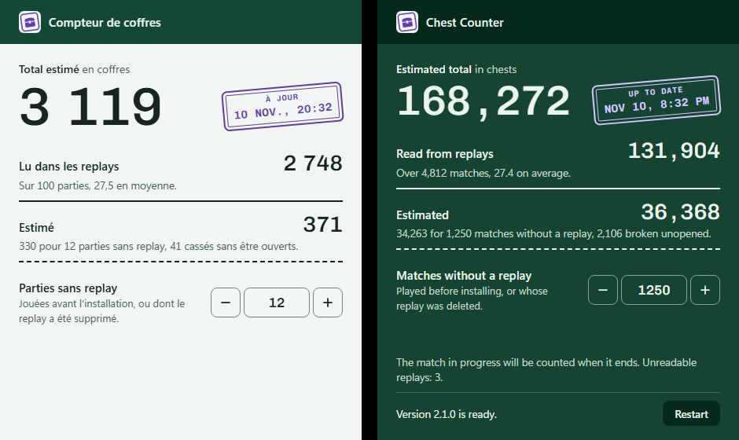

<p align="center">
  
</p>

<h1 align="center">Chest Counter</h1>

<p align="center">
  Count every chest you open in Fortnite, match by match, from the replays already on your PC.<br>
  A free and open-source Windows app that works offline.
</p>

<p align="center">
  <a href="https://github.com/Palawizard/chest-counter/releases/latest/download/Palawi.ChestCounter-win-Setup.exe"><strong>Download for Windows</strong></a>
  ·
  <a href="https://github.com/Palawizard/chest-counter/releases">All releases</a>
</p>



During the Treasure Hunters mini-season (from 1 November 2026), every chest you open is a chance at the rare Pirate Shop access token. Chest Counter tells you how many you have opened so far, and how that number was built.

It reads the replay files Fortnite saves after each match, finds every chest you opened in them, and keeps the result even after Fortnite deletes the replay. The window can stay open in the background: it updates on its own when a match ends.

## Features

- Each chest opening is read from your own replays.
- Matches without a replay and chests you broke instead of opening are estimated on a separate line, so the measured part of the total stays visible.
- Fortnite only keeps about 100 replays. Chest Counter saves every match it reads, so a deleted replay stays counted.
- No account or login, and no Epic or tracker API. Your replays stay on your PC.
- The window has a single field to fill in once, and nothing moves while you play.
- Your last match, today's chests and your best match sit under the total, and every counted match is listed with its chests by type.
- A Windows notification can tell you how many chests each match added.
- An optional overlay shows the total and your last match over the game, and an optional page shows them in OBS.
- It can open with Fortnite and stay by the clock, so you never have to start it yourself.
- French or English, depending on your Windows language.
- New versions install themselves from GitHub releases.

## How it compares

| | Chest Counter | Similar apps | Manual counters | In-game counter |
|---|---|---|---|---|
| Counts on its own | Yes | Yes | No, you press +1 after each chest | Yes |
| Counts the chests you break | Yes, estimated on a separate line | Yes, for most of them | Only if you press +1 for them too | No, only the chests you open |
| Keeps counting past 1,000 chests | Yes | Yes | Yes | No, players report it stops at the 1,000-chest stage |
| Makes up for matches whose replay is gone | Yes, estimated on a separate line | No, for most of them | No | Yes, it counts every match |

Compared in November 2026. The in-game counter is the official number: compare it with the **Read from replays** line, not with the estimated total.

## Install

1. Download [the installer](https://github.com/Palawizard/chest-counter/releases/latest/download/Palawi.ChestCounter-win-Setup.exe) and run it. It installs for your Windows user only, without administrator rights, and adds a shortcut to the Start menu and the desktop.
2. Windows SmartScreen may warn that the app is unrecognized, because the installer is not code-signed. Click **More info**, then **Run anyway**.
3. In Fortnite, turn on replay recording in the settings (Replays section). Chest Counter can only count matches that left a replay.

Requires Windows 10 or 11 (64-bit) and the Microsoft Edge WebView2 runtime, which Windows 11 already includes.

Updates download in the background. A new version is applied the next time you open the app, or right away with the **Restart** button that appears at the bottom of the window.

Uninstall from **Settings > Apps**. Uninstalling also removes the **Open with Fortnite** startup entry. Your counted matches are kept in `%LOCALAPPDATA%\ChestCounter` and survive an uninstall or reinstall.

## Usage

Open Chest Counter and leave it open or minimized while you play. A match is counted once it has ended: Fortnite encrypts the replay of a match in progress until the match is over.

The big number is the estimated total. The line under it, Read from replays, counts the chests opened in matches that have a replay; compare this one with the in-game counter. The next line, Estimated, adds the chests from matches without a replay and the chests you broke without opening them.

If you played matches before installing Chest Counter, or Fortnite already deleted their replays, enter how many in **Matches without a replay**. Those are almost always your oldest matches, played before you got better at finding chests, so they are estimated from your first 20 counted matches.

**Last match** shows your latest match: the chests you opened plus the ones you broke, estimated, when it ended, today's chests and your best match. **See all matches** lists every counted match with the same total and its opened chests by type. Under the big number, the average per match is the estimated total divided by all your matches. Today's line also gives your average per match for the day.

### Settings

The button at the top right opens the settings:

- **Notify me when each match ends**: a Windows notification with the match's chests.
- **Overlay while Fortnite runs**: the total and your last match over the game. It only shows while Fortnite runs, in windowed fullscreen (an overlay cannot draw over exclusive fullscreen). **Ctrl+Shift+O** hides or shows it, **Ctrl+Shift+L** lets you drag it somewhere else, then locks it again. The **Overlay** and **Move** buttons at the top right of the window do the same. Clicks go through it to the game.
- **Page for OBS**: shows an address such as `http://127.0.0.1:28470/`. Add a Browser source in OBS with it. The page is transparent and updates every few seconds.
- **Open with Fortnite**: a small process starts with Windows, waits quietly and opens Chest Counter in the notification area when Fortnite starts.

Closing the window keeps Chest Counter running by the clock, so the overlay, the OBS page and the notifications keep working. To quit, right-click the icon by the clock and choose **Quit**.

### Updating from 2.2 or earlier

Version 2.3 counts more accurately. Before, a chest you opened, left and saw again later was often counted a second time, so **Read from replays** goes down after the update. Your replays still on the PC are read again once. Matches counted by an older version whose replay is gone cannot be read again: they move to **Matches without a replay** and are estimated. The window shows the numbers before and after, once.

## What is counted

Every opening of a chest by you: regular, rare, buried, relic and wanted poster chests, and chest types added by game updates. A chest that refills and is opened again counts again; a chest you only see again does not. Ammo boxes, coolers and loot cannons are not counted.

## Limits

- Fortnite keeps about 100 replays. A match whose replay is deleted before the app reads it can only be estimated, so open Chest Counter at least once every 100 matches.
- Replays do not say who broke a chest. A chest destroyed while it still held loot counts for you when you were the closest player, within 10 m, of the loot it dropped. Your recorded position does not follow a vehicle, so a chest destroyed while you are driving counts for 0.7. This part is always shown as estimated.
- Relic finder chests cannot be attributed and are not counted.
- A match cut short by a crash leaves an unfinished replay. It is shown apart and cannot be counted; a match you quit from the menu is counted normally.
- All game modes found in the replay folder are counted.

## Privacy

Chest Counter only reads your replay folder (`%LOCALAPPDATA%\FortniteGame\Saved\Demos`) and never modifies it. The app itself only goes online to check this repository's GitHub releases for updates. The OBS page, when you turn it on, is only reachable from your own PC (`127.0.0.1`). **Open with Fortnite** adds a startup entry for your Windows user only, without administrator rights.

## Build from source

Requires the [.NET 10 SDK](https://dotnet.microsoft.com/download).

```
dotnet run --project src/ChestCounter -c Release
```

Optional arguments: `<replay folder> <state file>`.

Tests:

```
dotnet test --filter "Category!=RealReplay"
```

The tests marked `RealReplay` need a finished replay copied to `tests/fixtures/sample.replay` (git-ignored).

Installer and update packages are built with [Velopack](https://velopack.io). Install its CLI once with `dotnet tool install -g vpk --version 1.2.161`, then:

```
powershell -ExecutionPolicy Bypass -File scripts/release.ps1
```

The output is in `dist\releases`. Add `-Upload` to publish it as a draft GitHub release (uses the `gh` CLI login).

## License

[GPL-3.0](LICENSE). Replays are read with a copy of [FortniteReplayDecompressor](https://github.com/Shiqan/FortniteReplayDecompressor) by Shiqan (MIT), kept in `lib/` with a few fixes listed in its README. Its Kraken decompressor is a port of [ooz](https://github.com/powzix/ooz) by Powzix, under GPL-3.0-or-later. The figures use [Lilita One](https://github.com/google/fonts/tree/main/ofl/lilitaone) under the SIL Open Font License.

Chest Counter is not affiliated with or endorsed by Epic Games. Fortnite is a trademark of Epic Games, Inc.
